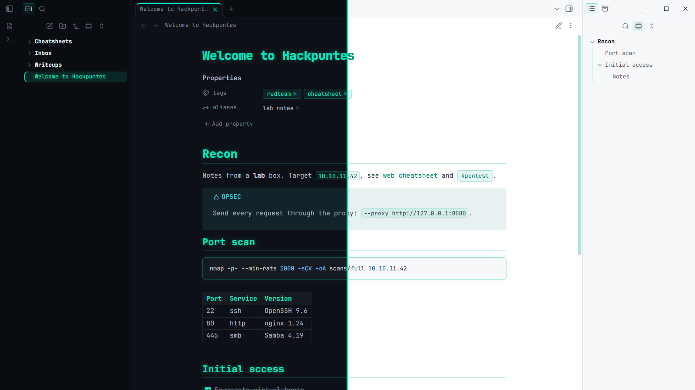
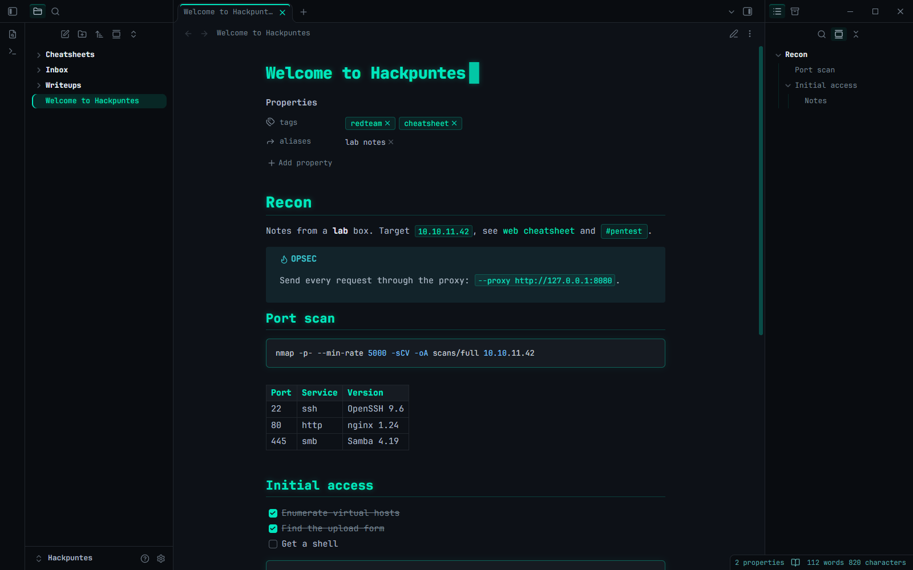
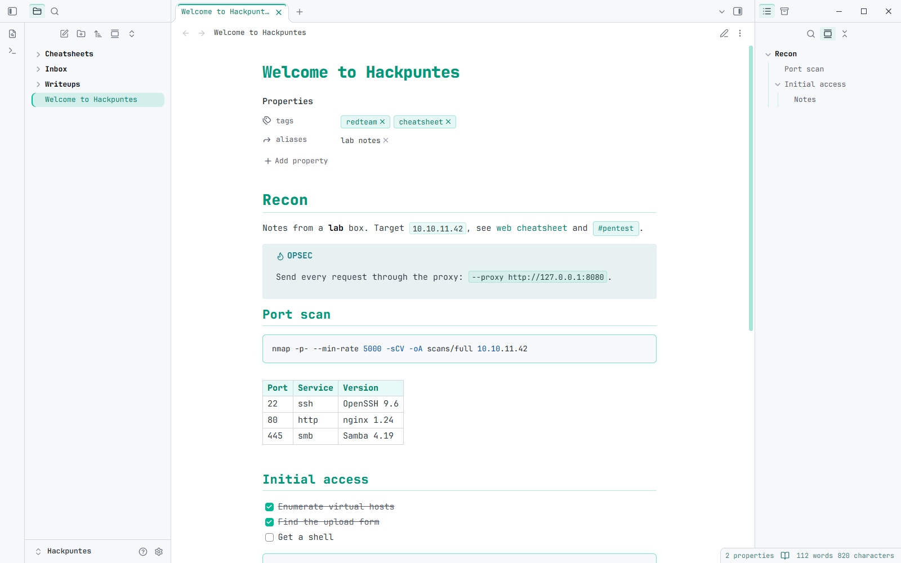
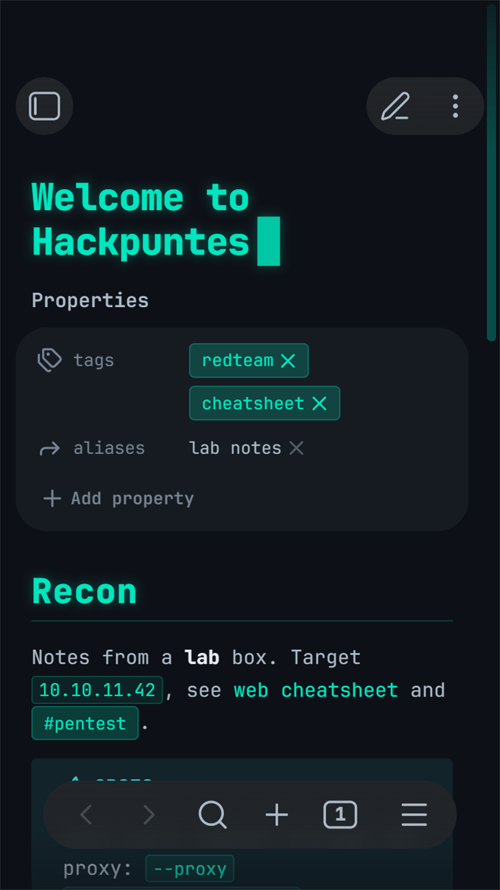
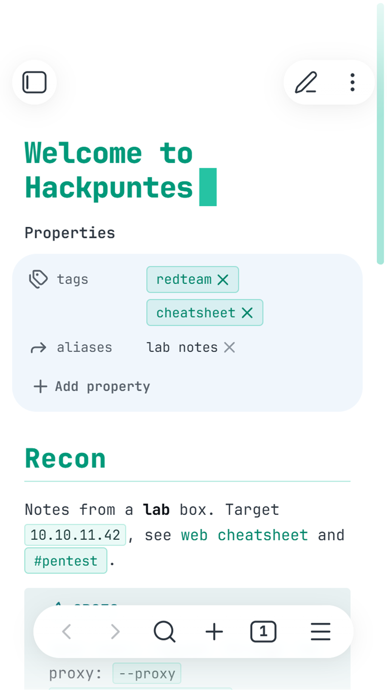
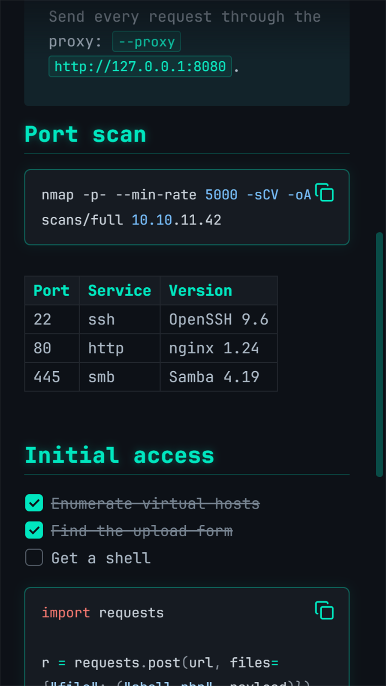
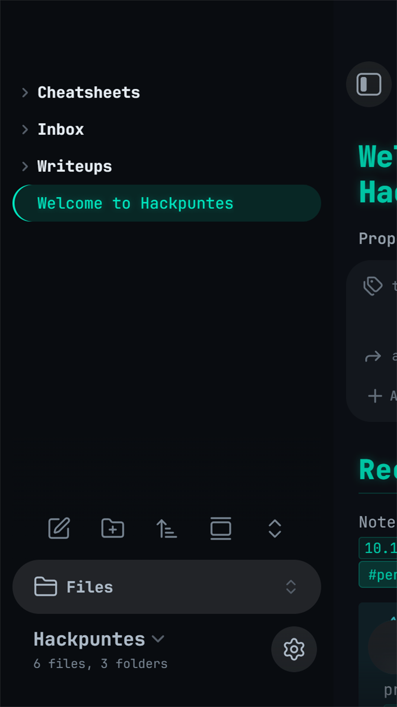

# 🛡️ Hackpuntes for Obsidian

A hacker-style theme for [Obsidian](https://obsidian.md), based on the look of [hackpuntes.com](https://hackpuntes.com): teal accent, glowing headings and JetBrains Mono everywhere, with dark and light modes. Made for pentest notes, cheatsheets and writeups full of commands.



## ✨ Features

- 🎨 **Hackpuntes palette**: background `#0d1117`, accent `#00e5be`, text `#adbac7`, GitHub-style syntax colors.
- 🔤 **JetBrains Mono embedded** in the theme, so it looks the same on desktop and mobile without installing fonts. No ligatures, so commands look exactly as typed.
- 💡 **Headings with a soft teal glow** and a thin rule under H1 and H2 to split long notes.
- 💻 **Code blocks** with a teal border and glow, teal inline code and `<kbd>` keys.
- 📋 **Tables, callouts, tags, checkboxes and quotes** styled to match.
- 🗂️ **File explorer and Outline** with a teal bar on hover and on the active item.
- 🎯 **Accent color**: change it in *Settings > Appearance > Accent color* and the whole theme follows.
- ☀️ **Light mode** with accessible contrast for links.
- 🔒 **No network requests**: everything is bundled in `theme.css`.

## 📸 Screenshots

| Dark | Light |
| ---- | ----- |
|  |  |

<p align="center">
  
  
  
  
</p>

## 📦 Installation

**From Obsidian**: *Settings > Appearance > Themes > Manage*, search for **Hackpuntes** and select *Install and use*.

**Manually**: download `theme.css` and `manifest.json` from the [latest release](../../releases/latest) into `<your vault>/.obsidian/themes/Hackpuntes/`, then pick *Hackpuntes* in *Settings > Appearance > Themes*.

## ⚙️ Options

With the [Style Settings](https://github.com/obsidian-community/obsidian-style-settings) plugin installed, go to *Settings > Style Settings > Hackpuntes*:

| Option | Default |
| ------ | ------- |
| Sans-serif note text | Off (everything in JetBrains Mono) |
| Sans-serif interface | Off |
| Disable heading glow | Off |
| Disable the blinking cursor after the note title (needs *Show inline title*) | Off |
| CRT scanlines | Off |
| Minimum left / right sidebar width | 0 (no minimum) |

The theme works fine without Style Settings; you just get the defaults.

## 🛠️ Development

`theme.css` is generated: edit `src/theme.src.css` and rebuild.

```bash
python src/build.py
```

`build.py` appends JetBrains Mono (`src/fonts/*.woff2`) to the end of `theme.css` as base64. Those fonts are a subset of the official ones (Latin, punctuation, arrows and box drawing, no ligatures) made with `src/subset_fonts.py`, which keeps `theme.css` around 100 KB.

To publish a new version:

1. Bump `version` in `manifest.json` (for example `1.0.1`).
2. Run `python src/build.py` and commit.
3. Push a tag with the same version: `git tag 1.0.1` and `git push origin 1.0.1`.

The [release workflow](.github/workflows/release.yml) checks that the tag matches `manifest.json` and that `theme.css` is up to date, then creates the GitHub release with `manifest.json` and `theme.css`, which is what Obsidian downloads.

## ☕ Support

If Hackpuntes makes your notes nicer, you can buy me a coffee:

[](https://buymeacoffee.com/javierolmedo)

## 📜 Credits and license

- Theme by [Javier Olmedo](https://hackpuntes.com), released under the [MIT License](LICENSE).
- [JetBrains Mono](https://github.com/JetBrains/JetBrainsMono) v2.304, Copyright 2020 The JetBrains Mono Project Authors, under the [SIL Open Font License 1.1](src/fonts/OFL.txt).

<div align="center">
    Made with ❤️ in Spain
</div>
