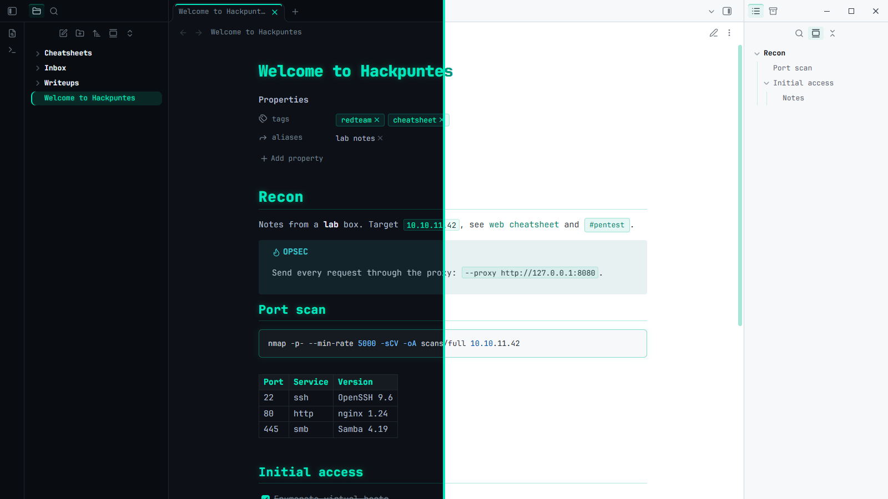
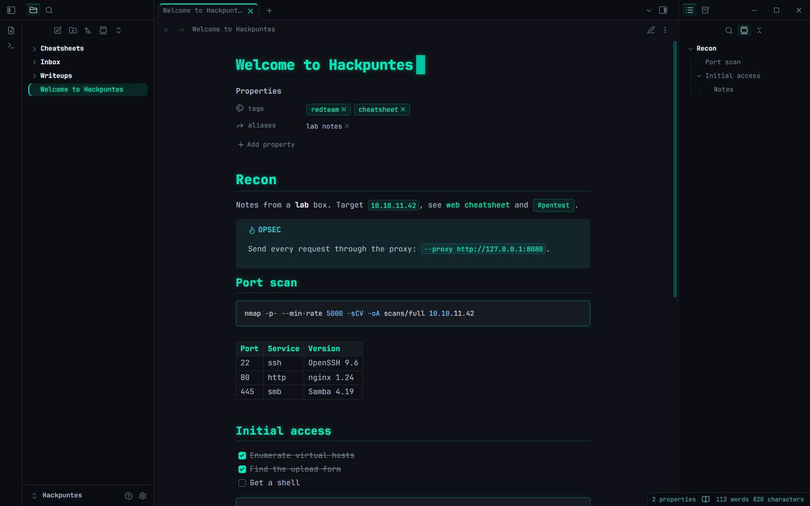
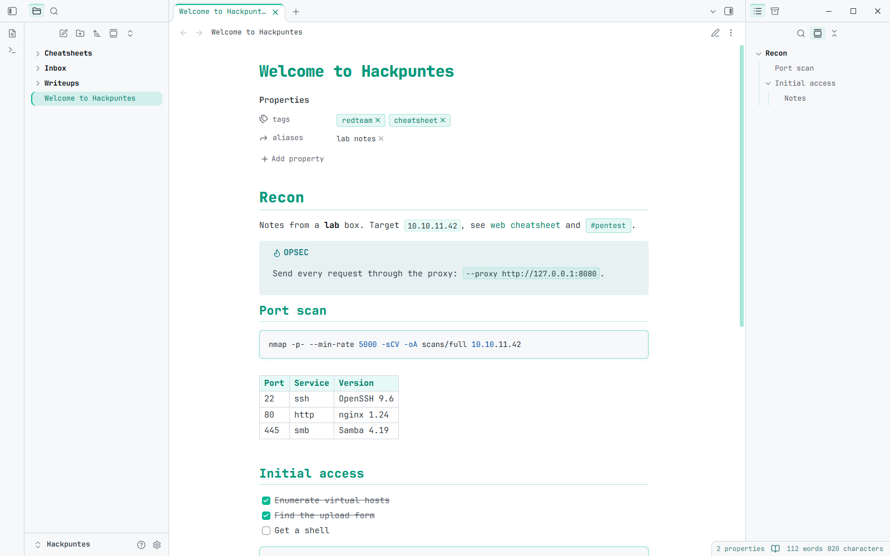
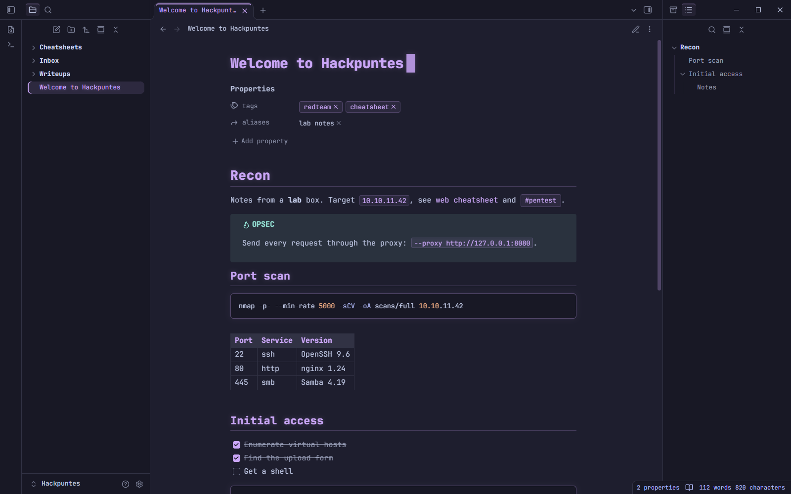
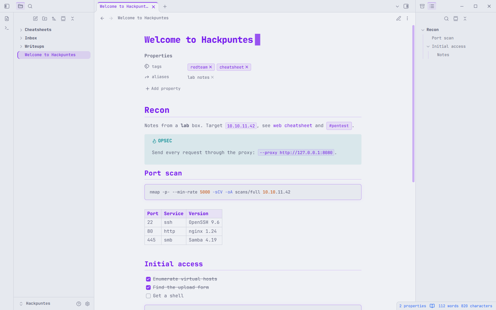
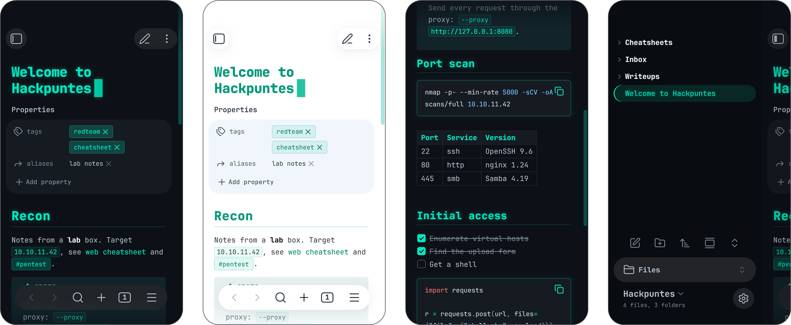
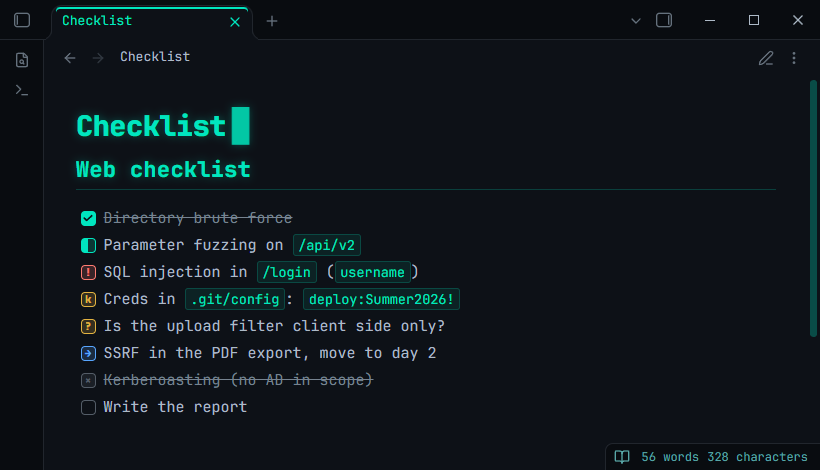

# 🛡️ Hackpuntes for Obsidian

A hacker-style theme for [Obsidian](https://obsidian.md), based on the look of [hackpuntes.com](https://hackpuntes.com): teal accent, glowing headings and JetBrains Mono everywhere, with dark and light modes. Made for pentest notes, cheatsheets and writeups full of commands.



## ✨ Features

- 🎨 **Hackpuntes palette**: background `#0d1117`, accent `#00e5be`, text `#adbac7`, GitHub-style syntax colors.
- 🔤 **JetBrains Mono embedded** in the theme, so it looks the same on desktop and mobile without installing fonts. No ligatures, so commands look exactly as typed.
- 💡 **Headings with a soft teal glow** and a thin rule under H1 and H2 to split long notes.
- 💻 **Code blocks** with a teal border and glow, teal inline code and `<kbd>` keys.
- 📋 **Tables, callouts, tags, checkboxes and quotes** styled to match.
- ☑️ **Extra checkbox states** for pentest checklists: `[!]`, `[?]`, `[/]`, `[-]`, `[k]` and more, each in its own color (see *Checkboxes* below).
- 🧜 **Mermaid diagrams** (flowcharts, sequence diagrams and mindmaps) in the theme colors.
- 🗂️ **File explorer and Outline** with a teal bar on hover and on the active item, and optional colors for numbered folders (`00_inbox`, `01_recon`…).
- 📄 **Dark PDFs** (optional): white PDF pages are inverted so they don't glare in dark mode.
- 🍬 **Pastel palette** (optional): soft colors on a blue-grey background, in dark and light mode, with three dark backgrounds and 14 accent colors to choose from.
- 🎯 **Accent color**: change it in *Settings > Appearance > Accent color* and the whole theme follows.
- ☀️ **Light mode** with accessible contrast for links.
- 🔒 **No network requests**: everything is bundled in `theme.css`.

## 📸 Screenshots

### 🖥️ Desktop

| Dark | Light |
| ---- | ----- |
|  |  |

### 🍬 Pastel palette

| Dark | Light |
| ---- | ----- |
|  |  |

### 📱 Mobile



## 📦 Installation

**From Obsidian**: *Settings > Appearance > Themes > Manage*, search for **Hackpuntes** and select *Install and use*.

**Manually**: download `theme.css` and `manifest.json` from the [latest release](../../releases/latest) into `<your vault>/.obsidian/themes/Hackpuntes/`, then pick *Hackpuntes* in *Settings > Appearance > Themes*.

## ⚙️ Options

With the [Style Settings](https://github.com/obsidian-community/obsidian-style-settings) plugin installed, go to *Settings > Style Settings > Hackpuntes*:

| Option | Default |
| ------ | ------- |
| Palette: *Hackpuntes* or *Pastel* | Hackpuntes |
| Pastel background in dark mode: *Deep*, *Medium* or *Soft* | Deep |
| Pastel accent: Mauve, Lavender, Blue, Sapphire, Sky, Teal, Green, Yellow, Peach, Maroon, Red, Pink, Flamingo or Rosewater | Mauve |
| Sans-serif note text | Off (everything in JetBrains Mono) |
| Sans-serif interface | Off |
| Disable heading glow | Off |
| Disable the blinking cursor after the note title (needs *Show inline title*) | Off |
| CRT scanlines | Off |
| Color numbered folders: top-level folders starting with two digits get a color from their last digit (those ending in 9, like `99_archive`, are muted) | Off |
| Dark PDF pages in dark mode (images inside the PDF are inverted too) | Off |
| Minimum left / right sidebar width | 0 (no minimum) |

The theme works fine without Style Settings; you just get the defaults.

## ☑️ Checkboxes

Besides `[ ]` and `[x]`, any character between the brackets shows up in a box of its own color, like `[!]` in a terminal:



| Write | Meaning | Write | Meaning |
| ----- | ------- | ----- | ------- |
| `- [/]` | In progress (half filled) | `- [k]` | Key, credentials found |
| `- [-]` | Cancelled or out of scope (struck through) | `- [i]` | Info |
| `- [!]` | Important, a finding | `- [I]` | Idea |
| `- [?]` | To check | `- [b]` | Bookmark |
| `- [>]` | Forwarded, for later | `- [l]` | Location, a host (`@`) |
| `- [<]` | Scheduled | `- [f]` | Fire, critical |
| `- [*]` | Star | `- [w]` | Win |
| `- ["]` | Quote | `- [S]` | Money, bounty (`$`) |
| `- [u]` / `- [d]` | Up / down (`↑` `↓`) | `- [p]` / `- [c]` | Pro / con (`+` `−`) |

Any other character shows a dot in the accent color.

## 🛠️ Development

`theme.css` is generated: edit `src/theme.src.css` and rebuild.

```bash
python src/build.py
```

`build.py` appends JetBrains Mono (`src/fonts/*.woff2`) to the end of `theme.css` as base64. Those fonts are a subset of the official ones (Latin, punctuation, arrows and box drawing, weights 400 to 800, no ligatures) made with `src/subset_fonts.py`. `theme.css` also leaves out the comments and indentation of `src/theme.src.css`, which keeps it under 100 KB (the Obsidian review warns about larger theme files).

To publish a new version:

1. Bump `version` in `manifest.json` (for example `1.0.1`).
2. Run `python src/build.py` and commit.
3. Push a tag with the same version: `git tag 1.0.1` and `git push origin 1.0.1`.

The [release workflow](.github/workflows/release.yml) checks that the tag matches `manifest.json` and that `theme.css` is up to date, then creates the GitHub release with `manifest.json` and `theme.css`, which is what Obsidian downloads.

## ☕ Support

If Hackpuntes makes your notes nicer, you can buy me a coffee:

[](https://buymeacoffee.com/javierolmedo)

## 📜 Credits and license

- Theme by [Javier Olmedo](https://hackpuntes.com), released under the [MIT License](LICENSE).
- [JetBrains Mono](https://github.com/JetBrains/JetBrainsMono) v2.304, Copyright 2020 The JetBrains Mono Project Authors, under the [SIL Open Font License 1.1](src/fonts/OFL.txt).

<div align="center">
    Made with ❤️ in Spain
</div>
