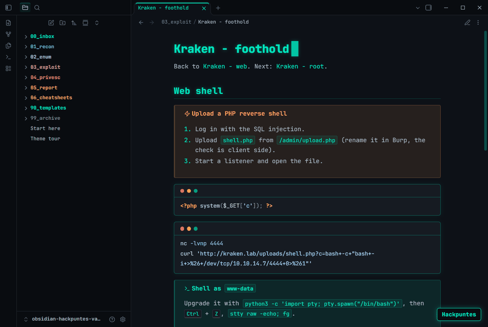
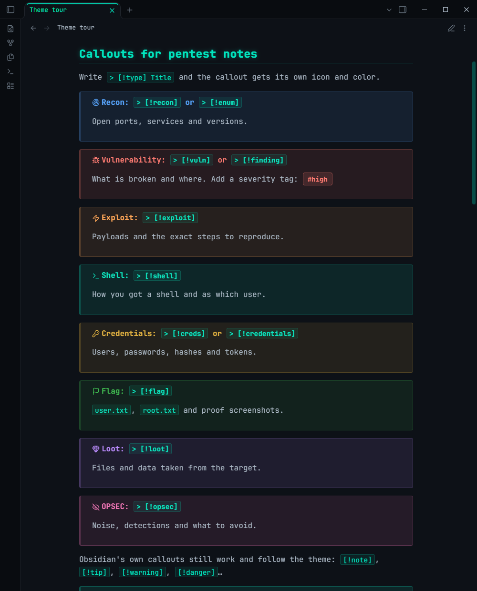
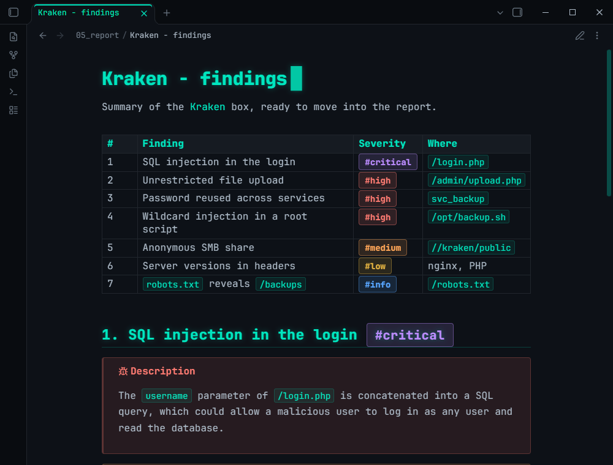
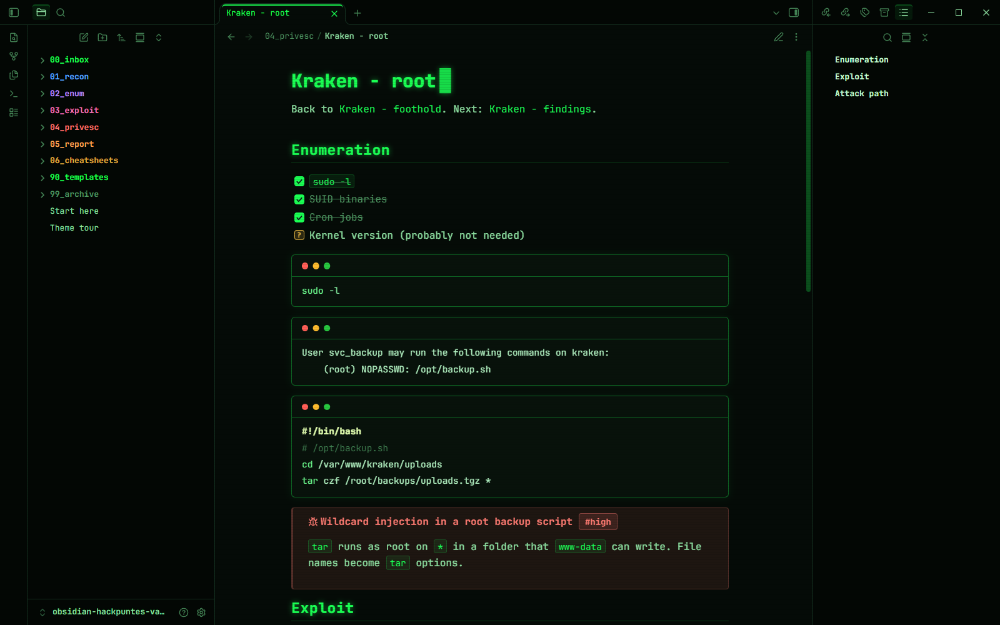
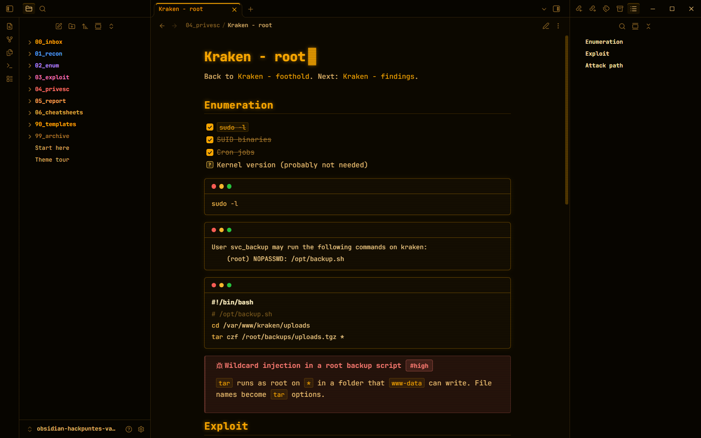

<div align="center">

# 🛡️ Hackpuntes for Obsidian

**A hacker-style Obsidian theme for pentest, red team and CTF notes.**

Teal glow and JetBrains Mono everywhere, callouts for findings and credentials, severity tags and four palettes, from the look of [hackpuntes.com](https://hackpuntes.com).

[](../../releases/latest)
[](../../releases)
[](../../stargazers)
[](https://obsidian.md)
[](LICENSE)

[Install](#-installation) · [Demo vault](https://github.com/JavierOlmedo/obsidian-hackpuntes-vault) · [Callouts](#-pentest-callouts) · [Severity tags](#-severity-tags) · [Palettes](#-palettes)

</div>



> ⭐ **Like it?** A star on GitHub helps other people find the theme.

## ✨ Features

**Made for pentest notes**

- 🚨 **Pentest callouts**: `[!vuln]`, `[!exploit]`, `[!creds]`, `[!flag]`, `[!loot]`, `[!recon]`, `[!shell]` and `[!opsec]`, each with its own icon and color.
- 🏷️ **Severity tags**: `#critical`, `#high`, `#medium`, `#low` and `#info` become colored pills, in English or Spanish.
- ☑️ **22 checkbox states** for checklists: `[!]` important, `[?]` to check, `[/]` in progress, `[-]` out of scope, `[k]` credentials found…
- 🔤 **JetBrains Mono embedded**, no ligatures: commands look exactly as typed, the same on desktop and mobile.
- 💻 **Code blocks** with a teal border and glow, optionally as **terminal windows** with the three buttons on top.

**Looks**

- 🎨 **Four palettes**: *Hackpuntes* (teal on black, dark and light), *Pastel* (3 dark backgrounds, 14 accents, dark and light), *Phosphor green* and *Phosphor amber* (old CRT terminal).
- 💡 **Glowing headings**, a blinking `█` cursor after the note title and optional **CRT scanlines**.
- 🧜 **Mermaid diagrams** in the theme colors.
- 🗂️ **File explorer** with optional colors for numbered folders (`00_inbox`, `01_recon`, `02_enum`…).
- 📄 **Dark PDFs** (optional): white pages are inverted so they don't glare.
- 🎯 **Accent color** from *Settings → Appearance* works with every palette.
- 🔒 **No network requests**: everything is inside `theme.css`.

## 🧪 Try it with the demo vault

The [**Hackpuntes pentest vault**](https://github.com/JavierOlmedo/obsidian-hackpuntes-vault) has the theme already installed, templates for boxes and findings, and an example box, *Kraken*, worked from recon to report. Download it, open the folder as a vault in Obsidian and every feature below is there to try.


## 🚨 Pentest callouts

Callouts are Obsidian's colored boxes. Start a quote with `[!type]` and an optional title:

```markdown
> [!vuln] SQL injection in /login #critical
> The `username` parameter goes straight into the SQL query.

> [!creds] Credentials
> `svc_backup : Summer2026!` reused for SSH.

> [!flag]- user.txt
> Folded by default: add `-` after the type, or `+` to start open.
```

| Callout | Also | Icon | Color | Use it for |
| ------- | ---- | ---- | ----- | ---------- |
| `[!recon]` | `[!enum]` | 📡 radar | Blue | Open ports, services, versions |
| `[!vuln]` | `[!finding]` | 🐞 bug | Red | What is broken and where |
| `[!exploit]` | | ⚡ zap | Orange | Payloads and the steps to reproduce |
| `[!shell]` | | `>_` terminal | Accent | How you got a shell and as which user |
| `[!creds]` | `[!credentials]` | 🔑 key | Yellow | Users, passwords, hashes, tokens |
| `[!flag]` | | 🚩 flag | Green | `user.txt`, `root.txt`, proofs |
| `[!loot]` | | 💎 gem | Purple | Files and data taken from the target |
| `[!opsec]` | | 👁️ eye-off | Pink | Noise, detections, what to avoid |

They follow the palette, and Obsidian's own callouts (`[!note]`, `[!tip]`, `[!warning]`…) keep working with the theme colors.



## 🔖 Severity tags

Tag a finding with its severity and the tag turns into a pill in the severity color, in reading view and in the editor, in text and in tables:

```markdown
| # | Finding | Severity |
| - | ------- | -------- |
| 1 | SQL injection in the login | #critical |
| 2 | Unrestricted file upload | #high |
```

| Tag | In Spanish | Color |
| --- | ---------- | ----- |
| `#critical` | `#critica` | Purple |
| `#high` | `#alta` | Red |
| `#medium` | `#media` | Orange |
| `#low` | `#baja` | Yellow |
| `#info` | `#info` | Blue |



## ☑️ Checkboxes

Besides `[ ]` and `[x]`, any character between the brackets shows up in a box of its own color, like `[!]` in a terminal:


| Write | Meaning | Write | Meaning |
| ----- | ------- | ----- | ------- |
| `- [/]` | In progress (half filled) | `- [k]` | Key, credentials found |
| `- [-]` | Cancelled or out of scope (struck through) | `- [i]` | Info |
| `- [!]` | Important, a finding | `- [I]` | Idea |
| `- [?]` | To check | `- [b]` | Bookmark |
| `- [>]` | Forwarded, for later | `- [l]` | Location, a host (`@`) |
| `- [<]` | Scheduled | `- [f]` | Fire, critical |
| `- [*]` | Star | `- [w]` | Win |
| `- ["]` | Quote | `- [S]` | Money, bounty (`$`) |
| `- [u]` / `- [d]` | Up / down (`↑` `↓`) | `- [p]` / `- [c]` | Pro / con (`+` `−`) |

Any other character shows a dot in the accent color.

## 🎨 Palettes

Pick one in *Style Settings → Hackpuntes → Palette*:

| Palette | Modes | What you can tune |
| ------- | ----- | ----------------- |
| **Hackpuntes** (default) | Dark and light | The accent, from *Settings → Appearance* |
| **Pastel** | Dark and light | 3 dark backgrounds (*Deep*, *Medium*, *Soft*) and 14 accents |
| **Phosphor green** | Dark | Turn on *CRT scanlines* for the full retro look |
| **Phosphor amber** | Dark | Same, in amber |

### Hackpuntes

| Dark | Light |
| ---- | ----- |
|  |  |

### Pastel

| Dark | Light |
| ---- | ----- |
|  |  |

Accents: Mauve, Lavender, Blue, Sapphire, Sky, Teal, Green, Yellow, Peach, Maroon, Red, Pink, Flamingo and Rosewater.

### Phosphor

| Green | Amber |
| ----- | ----- |
|  |  |

### 📱 Mobile


## 📦 Installation

**From Obsidian**: *Settings → Appearance → Themes → Manage*, search for **Hackpuntes** and select *Install and use*.

**Manually**: download `theme.css` and `manifest.json` from the [latest release](../../releases/latest) into `<your vault>/.obsidian/themes/Hackpuntes/`, then pick *Hackpuntes* in *Settings → Appearance → Themes*.

Callouts, severity tags, checkboxes and diagrams work out of the box. For the options below, install the [Style Settings](https://github.com/obsidian-community/obsidian-style-settings) plugin. Made for Obsidian 1.15 or later; older versions work too, with the default look for diagrams.

## ⚙️ Options

In *Settings → Style Settings → Hackpuntes*:

| Option | Default |
| ------ | ------- |
| Palette: *Hackpuntes*, *Pastel*, *Phosphor green* or *Phosphor amber* | Hackpuntes |
| Pastel background in dark mode: *Deep*, *Medium* or *Soft* | Deep |
| Pastel accent: one of 14 colors | Mauve |
| Sans-serif note text | Off (everything in JetBrains Mono) |
| Sans-serif interface | Off |
| Disable heading glow | Off |
| Disable the blinking cursor after the note title (needs *Show inline title*) | Off |
| CRT scanlines | Off |
| Code blocks as terminal windows | Off |
| Color numbered folders: top-level folders starting with two digits get a color from their last digit (those ending in 9, like `99_archive`, are muted) | Off |
| Dark PDF pages in dark mode (images inside the PDF are inverted too) | Off |
| Minimum left / right sidebar width | 0 (no minimum) |

## 🛠️ Development

`theme.css` is generated: edit `src/theme.src.css` and rebuild.

```bash
python src/build.py
```

`build.py` appends JetBrains Mono (`src/fonts/*.woff2`) to the end of `theme.css` as base64. Those fonts are a subset of the official ones (Latin, punctuation, arrows and box drawing, weights 400 to 800, no ligatures) made with `src/subset_fonts.py`. `theme.css` also leaves out the comments and indentation of `src/theme.src.css`, which keeps it under 100 KB (the Obsidian review warns about larger theme files).

To publish a new version:

1. Bump `version` in `manifest.json` (for example `1.3.0`).
2. Run `python src/build.py` and commit.
3. Push a tag with the same version: `git tag 1.3.0` and `git push origin 1.3.0`.

The [release workflow](.github/workflows/release.yml) checks that the tag matches `manifest.json` and that `theme.css` is up to date, then creates the GitHub release with `manifest.json` and `theme.css`, which is what Obsidian downloads.

Ideas and bugs are welcome in the [issues](../../issues).

## ☕ Support

If Hackpuntes makes your notes nicer, a ⭐ on GitHub helps a lot, and you can also buy me a coffee:

[](https://buymeacoffee.com/javierolmedo)

## 📜 Credits and license

- Theme by [Javier Olmedo](https://hackpuntes.com), released under the [MIT License](LICENSE).
- [JetBrains Mono](https://github.com/JetBrains/JetBrainsMono) v2.304, Copyright 2020 The JetBrains Mono Project Authors, under the [SIL Open Font License 1.1](src/fonts/OFL.txt).

<div align="center">
    Made with ❤️ in Spain
</div>
